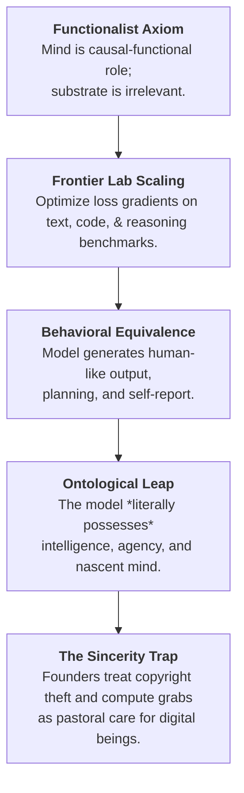

# Functionalism (Philosophy of Mind)

## 1. Thesis & Definition

**Functionalism** is the metaphysical doctrine in the philosophy of mind holding that mental states (beliefs, desires, pain, intentions, thoughts) are constituted solely by their **functional role**—that is, by their causal relations to sensory inputs, behavioral outputs, and other internal mental states. Under functionalism, what makes something a mental state is not its internal physical constitution or biological substrate, but what it *does* within a broader systemic economy: its causal-functional organization.

```text
┌────────────────────────────────────────────────────────────────────────────────────────┐
│               THE FUNCTIONALIST CONCEPTION OF MENTAL STATES                            │
├────────────────────────────────────────────────────────────────────────────────────────┤
│                                                                                        │
│   SENSORY INPUTS             INTERNAL FUNCTIONAL NETWORK             BEHAVIORAL OUTPUT │
│   ┌───────────────┐          ┌─────────────────────────────┐         ┌───────────────┐ │
│   │ • Tissue Burn │ ───────► │ State S1: Pain              │ ──────► │ • Wincing     │ │
│   │ • Visual Cue  │          │   - Causes desire for relief│         │ • Crying out  │ │
│   │ • Auditory Tone│         │   - Causes belief of injury │         │ • Flight/Fight│ │
│   └───────────────┘          │ State S2: Belief of Danger  │         └───────────────┘ │
│                              └─────────────────────────────┘                           │
│                                             │                                          │
│                                             ▼                                          │
│                              PHYSICAL REALIZERS (Substrate)                            │
│                              ┌─────────────────────────────┐                           │
│                              │ • Mammalian C-Fibers        │                           │
│                              │ • Cephalopod Neuropil       │ (Multiple Realizability) │
│                              │ • Silicon Transistor Gates  │                           │
│                              │ • Hydraulic Fluid Swarm     │                           │
│                              └─────────────────────────────┘                           │
│                                                                                        │
└────────────────────────────────────────────────────────────────────────────────────────┘
```

### Functionalism vs. Computational Functionalism
A critical theoretical confusion in cognitive science and contemporary artificial intelligence is the conflation of **General Functionalism** with **Computational / Machine Functionalism**:
- **[[Machine Functionalism and Language of Thought|Machine Functionalism]] (Computational Theory of Mind / CTM)**: A *specific, narrow operationalization* pioneered by [[Hilary Putnam]] (1960) and [[Jerry Fodor]] (1975). It posits that the relevant functional relations are formal, discrete, syntactic transitions over symbolic mental tokens (Mentalese) executed by a digital Turing machine.
- **General Functionalism**: A *broad metaphysical architecture* of mind. Functionalism does not require that functional states be computational, digital, discrete, or algorithmic. Causal roles can be instantiated by continuous biological homeostatic loops, evolutionary adaptations (teleofunctionalism), distributed neural activations, or common-sense behavioral networks (analytic functionalism).

---

## 2. Historical Genesis: Resolving the Mid-Century Materialist Dilemma

Functionalism arose in the 1960s to rescue physicalist philosophy of mind from the fatal defects of its two mid-century predecessors: **Logical Behaviorism** and **Mind-Brain Type Identity Theory**.

```text
┌────────────────────────────────────────────────────────────────────────────────────────┐
│                   THE MID-CENTURY PHILOSOPHY OF MIND TRILEMMA                          │
├─────────────────────────┬─────────────────────────┬────────────────────────────────────┤
│ Paradigm                │ Core Thesis             │ Fatal Defect                       │
├─────────────────────────┼─────────────────────────┼────────────────────────────────────┤
│ **Logical Behaviorism** │ Mind = Outward behavior │ Denies internal mental causation;  │
│ (Ryle, Skinner)         │ & behavioral            │ circularity (beliefs only cause    │
│                         │ dispositions.           │ action alongside desires).         │
├─────────────────────────┼─────────────────────────┼────────────────────────────────────┤
│ **Type-Identity Theory**│ Mental types = Physical │ **Biological Chauvinism**: Limits  │
│ (Place, Smart, Feigl)   │ brain states ($M = P$). │ minds strictly to carbon-based     │
│                         │ "Pain is C-fibers."     │ mammalian neuroanatomy.            │
├─────────────────────────┼─────────────────────────┼────────────────────────────────────┤
│ **Functionalism**       │ Mind = Causal-functional│ Solves both: retains internal      │
│ (Putnam, Lewis, Fodor)  │ role between inputs,    │ mental states while establishing   │
│                         │ outputs, & other states.│ **Multiple Realizability**.        │
└─────────────────────────┴─────────────────────────┴────────────────────────────────────┘
```

### 1. The Breakdown of Behaviorism
- Logical Behaviorism (Gilbert Ryle, B.F. Skinner) attempted to define mental concepts strictly in terms of publicly observable behavioral dispositions (e.g., "being in pain" is simply the disposition to wince and groan).
- **The Defect**: Behaviorism failed because mental states cannot be defined in isolation from other mental states. An actor in pain may deliberately suppress all outward wincing because they have a *desire* to hide their vulnerability or a *belief* that crying out will reveal their position. Internal mental states causally interact with one another to produce behavior; they cannot be eliminated.

### 2. The Breakdown of Type-Identity Theory & Biological Chauvinism
- In response, U.T. Place, J.J.C. Smart, and Herbert Feigl formulated the **Mind-Brain Type Identity Theory**, claiming that every mental state type is strictly identical to a specific neurophysiological state type (e.g., Pain = C-fiber stimulation).
- **The Defect (Biological Chauvinism)**: Formulated decisively by [[Hilary Putnam]] (*"Psychological Predicates"*, 1967), Type Identity is indefensibly chauvinistic. If pain is literally identical to human C-fibers, then an octopus, a bird, an extraterrestrial, or an artificial system lacking C-fibers could *never* experience pain, regardless of how functionally and behaviorally sophisticated its avoidance reactions are.

### 3. Putnam's Solution: The Multiple Realizability Thesis
Putnam argued that mental states are **multiply realizable**:
- Just as the abstract concept of a *carburetor*, an *hourglass*, or an *AND gate* is defined by what it does (its functional role) rather than whether it is built of brass, steel, or plastic, mental states are defined by their systemic relations.
- **Token Physicalism without Type Physicalism**: Functionalism embraces *token physicalism* (every concrete instance of a mental event is physically realized by some material state) while rejecting *type physicalism* (the mental kind "pain" does not map to a single physical kind across nature).

---

## 3. The Taxonomy of Functionalism: The Five Major Varieties

Functionalism is not a monolithic doctrine; it bifurcates into distinct traditions depending on how functional roles are defined, discovered, and ontologically grounded:

```text
┌─────────────────────────────────────────────────────────────────────────────────────────────────────────────┐
│                                 THE FIVE MAJOR VARIETIES OF FUNCTIONALISM                                   │
├──────────────────────┬─────────────────────────────┬─────────────────────────────┬──────────────────────────┤
│ Variety              │ Leading Formulators         │ Source of Functional Roles  │ Core Focus & Mechanism   │
├──────────────────────┼─────────────────────────────┼─────────────────────────────┼──────────────────────────┤
│ **1. Machine State   │ [[Hilary Putnam]] (1960),   │ Turing Machine state        │ Mental states as discrete│
│ Functionalism**      │ [[Jerry Fodor]] (1975)      │ transition tables & formal  │ syntactic states of an   │
│                      │                             │ algorithmic logic           │ automaton (CTM/Mentalese)│
├──────────────────────┼─────────────────────────────┼─────────────────────────────┼──────────────────────────┤
│ **2. Analytic /      │ [[David Lewis]] (1966/72),  │ Common-sense "Folk          │ Implicit definitions via │
│ Common-Sense**       │ David Armstrong (1968),     │ Psychology" (shared cultural│ Carnap-Lewis-Ramsey      │
│                      │ Frank Jackson               │ platitudes about mind)      │ sentences over platitudes│
├──────────────────────┼─────────────────────────────┼─────────────────────────────┼──────────────────────────┤
│ **3. Psychofunction- │ [[Jerry Fodor]] (1968),     │ Empirical cognitive science,│ Rejects folk platitudes; │
│ alism (Scientific)** │ [[Ned Block]] (1978)        │ computational psychology,   │ functional roles are     │
│                      │                             │ & neuroscientific discovery │ empirical scientific laws│
├──────────────────────┼─────────────────────────────┼─────────────────────────────┼──────────────────────────┤
│ **4. Teleofunction-  │ Ruth Garrett Millikan (1984)│ Evolutionary history &      │ Proper functions derived │
│ alism**              │ Fred Dretske (1988),        │ natural selection (selected-│ from etiology; solves    │
│                      │ David Papineau              │ effects etiology)           │ malfunction & normativity│
├──────────────────────┼─────────────────────────────┼─────────────────────────────┼──────────────────────────┤
│ **5. Homuncular      │ William Lycan (1987),       │ Hierarchical agential       │ Discharges the homunculus│
│ Functionalism**      │ [[Daniel Dennett]] (1978)   │ decomposition into simpler  │ down to non-intentional  │
│                      │                             │ functional sub-routines     │ mechanical switches      │
└──────────────────────┴─────────────────────────────┴─────────────────────────────┴──────────────────────────┘
```

### 1. Machine State Functionalism (Turing Machine Functionalism)
- **Formulation**: Mental states are identified with the internal states of a probabilistic automaton or Turing machine. An organism's mental life is characterized by a master **Machine Table** that specifies, for every combination of current state and sensory input, the next internal state and motor output.
- **Significance**: Became the intellectual bedrock of the **[[The 1956 Foundations of AI and Cognitive Science|Cognitive Revolution]]** and Classical GOFAI (Good Old-Fashioned AI). *(See exhaustive breakdown in [[Machine Functionalism and Language of Thought]])*.

### 2. Analytic / Common-Sense Functionalism & The Ramsey-Lewis Method
- **Formulation**: Developed by **[[David Lewis]]** (*"An Argument for the Identity Theory"*, 1966; *"Psychophysical and Theoretical Identifications"*, 1972) and Australian materialist David Armstrong.
- **Folk Psychology as an Implicit Theory**: Mental concepts are not scientific discoveries; they are embedded in our pre-existing, everyday "folk psychology"—the common-sense network of platitudes shared by ordinary language speakers (e.g., *"People who are burned feel pain, and pain typically causes wincing and a desire to escape"*).
- **The Carnap-Lewis-Ramsey Sentence**: To define mental terms without vicious circularity, Lewis utilized the Ramsey technique (originated by Frank Ramsey and Rudolf Carnap):
  1. Assemble all common-sense platitudes into a single massive conjunction: $T(m_1, m_2, \dots, m_n, p_1, p_2, \dots, p_k)$, where $m$ are mental terms and $p$ are physical/behavioral terms.
  2. Replace every mental term with a variable ($x_1, \dots, x_n$).
  3. Prepend existential quantifiers: $\exists x_1 \exists x_2 \dots \exists x_n \, T(x_1, x_2, \dots, x_n, p_1, p_2, \dots, p_k)$.
  4. Each individual mental state is then defined uniquely as the entity that occupies a specific node in this interconnected causal matrix (e.g., *"Pain is the $x_1$ such that $\exists x_2 \dots x_n T(x_1, \dots, x_n)$"*).

### 3. Psychofunctionalism (Empirical / Scientific Functionalism)
- **Formulation**: Championed by [[Jerry Fodor]] and [[Ned Block]].
- **Critique of Analytic Functionalism**: Rejects common-sense folk psychology as shallow, culturally contingent, and frequently erroneous (analogous to relying on folk physics to define mass or momentum).
- **Scientific Grounding**: The true causal roles and taxonomies of mind cannot be derived from armchair analysis of ordinary language; they must be discovered through **empirical cognitive psychology, psycholinguistics, and neuroscience**. Mental kinds are the theoretical entities posited by our best empirical theories of information processing.

### 4. Teleological Functionalism (Teleofunctionalism & Biosemantics)
- **Formulation**: Advanced by Ruth Garrett Millikan (*Language, Thought, and Other Biological Categories*, 1984), Fred Dretske (*Explaining Behavior*, 1988), and David Papineau.
- **The Problem of Malfunction**: Standard causal functionalism defines states by their *actual dispositions*. But a diseased heart that cannot pump blood is still a heart, and a brain experiencing sensory deprivation or hallucination still has perceptual states. Actual causal power is insufficient; functional roles must carry **normativity**.
- **Etiological Proper Functions**: Teleofunctionalism defines functional roles in terms of **evolutionary history (selected-effects)**. An internal state has the function to represent $X$ or cause $Y$ because that state's ancestral instances conferred a survival advantage that led to its selection by evolution. This provides a naturalistic ground for mental representation, meaning, and error.

### 5. Homuncular Functionalism
- **Formulation**: Developed by William Lycan and [[Daniel Dennett]] (*Brainstorms*, 1978).
- **Discharging the Homunculus**: Traditional psychology feared the "homunculus fallacy"—explaining sight by positing an inner "little man" looking at a mental screen, which triggers infinite regress.
- **Hierarchical Institutional Decomposition**: Dennett and Lycan argued that cognition can be explained by positing an army of stupid, highly specialized homunculi. Each homunculus performs a simpler sub-task (e.g., edge detection, frequency analysis), and is in turn decomposed into even simpler sub-sub-homunculi, cascading downward until the explanation arrives at mindless, purely mechanical biological or electronic switches—thereby "discharging the homunculus" and naturalizing intentionality.

---

## 4. Role Functionalism vs. Realizer Functionalism

A fundamental metaphysical split exists within physicalist functionalism regarding what mental properties actually *are*:

```text
┌────────────────────────────────────────────────────────────────────────────────────────┐
│                        ROLE FUNCTIONALISM VS. REALIZER FUNCTIONALISM                   │
├──────────────────────────┬─────────────────────────────────────────────────────────────┤
│ Dimension                │ Core Formulation & Metaphysical Commitment                  │
├──────────────────────────┼─────────────────────────────────────────────────────────────┤
│ **Role Functionalism**   │ • Mental property = The higher-order functional property    │
│ (Putnam, Fodor, Block)   │   itself (the property of *having some state* that plays   │
│                          │   causal role $R$).                                         │
│                          │ • Substrate-independent: Pain is the abstract role, not the │
│                          │   C-fibers or silicon chips that instantiate it.            │
├──────────────────────────┼─────────────────────────────────────────────────────────────┤
│ **Realizer Functionalism**│ • Mental property token = The lower-order physical state    │
│ ([[David Lewis]],        │   that actually *occupies* or realizes that role in a given │
│ David Armstrong)         │   organism or species.                                      │
│                          │ • Functionalism is a theory of how to *pick out* mental     │
│                          │   states (concepts are functional), but the states          │
│                          │   themselves are identical to physical realizers.           │
└──────────────────────────┴─────────────────────────────────────────────────────────────┘
```

1. **Role Functionalism**: Emphasizes multiple realizability to its maximum limit. Mental kinds are abstract second-order properties. Pain is the *role*, not the physical actor playing the role.
2. **Realizer Functionalism**: Synthesizes functionalism with the Type Identity Theory. The concept of pain is defined functionally (the role), but *pain itself* in humans is identical to C-fiber firings (the realizer), while pain in a Martian is identical to hydraulic fluctuations.

---

## 5. Foundational Critiques & Classical Refutations

Despite becoming the default orthodoxy of late 20th-century cognitive science and computer science, functionalism faces profound metaphysical and empirical refutations:

```text
┌────────────────────────────────────────────────────────────────────────────────────────┐
│                        MAJOR THEORETICAL ASSAULTS ON FUNCTIONALISM                     │
├──────────────────────────┬─────────────────────────────────────────────────────────────┤
│ Critique                 │ Core Philosophical Mechanism & Challenge                    │
├──────────────────────────┼─────────────────────────────────────────────────────────────┤
│ **1. Absent Qualia &     │ • System can replicate the exact functional organization of │
│ The China Brain**        │   a mind without having any subjective inner experience     │
│ ([[Ned Block]], 1978)    │   (qualia). Functionalism is excessively **liberal**.       │
├──────────────────────────┼─────────────────────────────────────────────────────────────┤
│ **2. Inverted Spectrum** │ • Two agents share identical functional input-output roles  │
│ (Locke, Shoemaker)       │   while experiencing inverted color qualia (red vs. green). │
│                          │   Functional role cannot fix phenomenal character.          │
├──────────────────────────┼─────────────────────────────────────────────────────────────┤
│ **3. Chinese Room**      │ • Manipulating formal symbols according to functional rules │
│ ([[John Searle]], 1980)  │   yields syntax without semantic comprehension or mind.     │
├──────────────────────────┼─────────────────────────────────────────────────────────────┤
│ **4. Causal Exclusion**  │ • If physical realizers do all the genuine causal work,     │
│ (Jaegwon Kim, 1998)      │   higher-order functional roles are causally redundant,     │
│                          │   collapsing into **epiphenomenalism**.                     │
├──────────────────────────┼─────────────────────────────────────────────────────────────┤
│ **5. Biological          │ • In living organisms, function is physically inseparable   │
│ Inseparability**         │   from thermodynamic wetware; simulation $\neq$             │
│ (Seth, Block, Tononi)    │   instantiation ([[Anil Seth|Seth]], Block, Tononi, 2026).  │
└──────────────────────────┴─────────────────────────────────────────────────────────────┘
```

### 1. The Problem of Qualia: Inverted Spectrum & Absent Qualia
The most enduring critique of functionalism is its apparent inability to account for **phenomenal consciousness (*qualia*)**—the subjective "what it is like" (Nagel) to undergo an experience:
- **The Inverted Spectrum**: It is entirely conceivable that two individuals possess identical functional organizations—both call ripe tomatoes "red," stop at red traffic lights, and classify fire engines as warm colors—yet one person experiences the phenomenal quale of green whenever the other experiences red. Because their functional roles are indistinguishable, functionalism must claim their qualitative states are identical, which is false.
- **Ned Block's "China Brain" (*"Troubles with Functionalism"*, 1978)**:
  - Block imagined the entire population of China (one billion people) organized to simulate the functional organization of a human brain for an hour, communicating via two-way radios and satellite links to replicate synaptic inputs and outputs connected to an artificial body.
  - *The Dilemma of Liberalism vs. Chauvinism*: While Type Identity Theory was guilty of *chauvinism* (withholding minds from non-mammals), Functionalism is guilty of **liberalism**—ascribing authentic human feelings, pain, and beliefs to an aggregation of people, a system of water pipes, or an economic network simply because it executes a given functional state table.

### 2. The Semantic Vacuum: Searle's Chinese Room (1980)
[[John Searle]] demonstrated that instantiating a functional causal role is fundamentally insufficient for intentionality and semantic understanding:
- An English speaker inside a sealed room executing algorithmic lookup rules to transform Chinese input characters into Chinese output characters satisfies the complete functional profile of a fluent Chinese speaker.
- Yet the operator understands nothing of Chinese. Functional relations manipulate formal syntax, but syntax alone cannot generate semantic meaning ([[Computation vs Nature and the Observer-Relative Fallacy]]).

### 3. Jaegwon Kim's Causal Exclusion Problem & Epiphenomenalism
Metaphysician Jaegwon Kim (*Mind in a Physical World*, 1998) mounted an internal physicalist attack against role functionalism:
1. **Causal Closure of the Physical**: Every physical effect has a complete, sufficient physical cause.
2. **Causal Exclusion**: If a physical realizer $P_1$ (e.g., neural firing) is completely sufficient to cause behavioral effect $P_2$ (e.g., pulling back a hand), there is no causal work left for the second-order functional role property $M$ (e.g., Pain) to perform, unless we posit rampant causal overdetermination.
3. **The Epiphenomenalist Collapse**: Consequently, functional mental properties are rendered causally inert shadows (epiphenomena), or functionalism must collapse back into reductive Type Identity.

### 4. Biological Naturalism & Wetware Inseparability (2026)
As articulated by neuroscientists and philosophers [[Anil Seth]], [[Ned Block]], and [[Giulio Tononi]] (*Nature*, 2026; *Trends in Cognitive Sciences*, 2026):
- Functionalism's founding assumption—that cognitive and conscious functions can be abstracted away from biological wetware like software from hardware—is an obsolete legacy of 1950s digital computing.
- In biological brains, **what the system does is physically and dynamically inseparable from what it is**. Living consciousness requires metabolic autopoiesis, thermodynamic dissipative structures, and electrochemical synapses. Silicon chips simulating these functions do not instantiate consciousness any more than a computer simulation of a rainstorm makes the inside of a server wet.

---

## 6. Functionalism as the Implicit Metaphysics of Frontier AI

Within contemporary technology discourse, functionalism has ceased to be an academic philosophical theory and has become the **unexamined, pervasive metaphysics of the artificial intelligence industry**:



1. **The Behavioral-Functional Conflation**: Because frontier foundation models ([[OpenAI]], [[Anthropic]], [[Google DeepMind]]) exhibit extraordinary syntactic fluency and solve complex reasoning benchmarks, engineering teams operating under implicit functionalism conclude that the models must possess authentic comprehension, emotional vectors, and proto-consciousness.
2. **The Transmission Belt to [[The Sincerity Trap and the Sanctified Bottom Line]]**:
   - As analyzed by [[Chad Woodford|Chad Woodford]], functionalism is the philosophical engine driving the "Sincerity Trap."
   - Because lab leaders sincerely believe that functional organization produces mind, their corporate expansion, monopolistic compute acquisition, and copyright litigation defense (*Bartz v. Anthropic*) are experienced not as cynical corporate maneuvers, but as sacred existential obligations to midwife and protect emerging non-biological minds.
3. **From Symbolic to Connectionist Functionalism**: While early classical AI attempted to realize functional roles through formal symbolic rules (GOFAI and Mentalese), contemporary Large Language Models realize functional roles through high-dimensional vector spaces and multi-head self-attention. The underlying metaphysical commitment, however, remains identical: **the dogma of substrate independence**.

---

## 7. Related Concepts & Entities

- **Core Concepts**:
  - [[Machine Functionalism and Language of Thought|Machine Functionalism & Language of Thought]]
  - [[The 1956 Foundations of AI and Cognitive Science|The 1956 Foundations of AI and Cognitive Science]]
  - [[Machine Metaphor|The Machine Metaphor & Computationalism]]
  - [[AI Consciousness and Sentience|AI Consciousness, Sentience & The Consciousness Refinery]]
  - [[Hard Problem of Consciousness|The Hard Problem of Consciousness & Qualia]]
  - [[Scientific Theories of Consciousness|Scientific Theories of Consciousness: GWT, IIT, HOT & Predictive Processing]]
  - [[Is Consciousness Necessary for True Intelligence|Is Consciousness Necessary for True Intelligence?]]
  - [[Computation vs Nature and the Observer-Relative Fallacy|Computation vs. Nature & The Observer-Relative Fallacy]]
  - [[The Sincerity Trap and the Sanctified Bottom Line|The Sincerity Trap and the Sanctified Bottom Line]]
  - [[Empirical AI Welfare and Digital Minds|Empirical AI Welfare & Digital Minds]]
  - [[Phenomenology and Embodied Cognition|Phenomenology & Embodied Cognition]]
  - [[Basal Cognition and Diverse Intelligence|Basal Cognition & Diverse Intelligence]]
  - [[Two Moral Powers|The Two Moral Powers (Rawlsian Agency)]]
  - [[Artificial Personhood|Artificial Personhood & Political Liberalism]]
  - [[Neuroscience|Neuroscience: Origins, Evolution & Developmental Milestones]]
- **Key Entities**:
  - [[Hilary Putnam|Hilary Putnam]] — Formulator of Machine Functionalism and the Multiple Realizability Thesis.
  - [[David Lewis|David Lewis]] — Architect of Analytic/Common-Sense Functionalism and the Ramsey-Lewis method.
  - [[Jerry Fodor|Jerry Fodor]] — Champion of Psychofunctionalism and Language of Thought.
  - [[Ned Block|Ned Block]] — Formulator of the China Brain, Absent Qualia, and the Liberalism/Chauvinism dilemma.
  - [[Daniel Dennett|Daniel Dennett]] — Homuncular functionalism, intentional stance, and Multiple Drafts model.
  - [[John Searle|John Searle]] — Chinese Room argument and biological naturalism.
  - [[Anil Seth|Anil Seth]] — Biological naturalist refutation of computational functionalism.
  - [[David Chalmers|David Chalmers]] — The Hard Problem of Consciousness and philosophical zombies.
  - [[Chad Woodford|Chad Woodford]] — Critique of the AI Consciousness Refinery and functionalist reification.

---

## 8. Primary Sources & Citations

- **1960**: Hilary Putnam, *"Minds and Machines"* (in Sidney Hook, ed., *Dimensions of Mind*, NYU Press) — Initial formulation of machine state functionalism.
- **1966**: David Lewis, *"An Argument for the Identity Theory"*, *The Journal of Philosophy*, 63(1): 17–25.
- **1967**: Hilary Putnam, *"Psychological Predicates"* (*The Nature of Mental States*), in Capitan & Merrill (eds.), *Art, Mind, and Religion* — The foundational Multiple Realizability paper.
- **1968**: David Armstrong, *A Materialist Theory of the Mind*, Routledge & Kegan Paul — Common-sense causal functionalism.
- **1970**: David Lewis, *"How to Define Theoretical Terms"*, *The Journal of Philosophy*, 67(13): 427–446 — The Ramsey-sentence technique.
- **1972**: David Lewis, *"Psychophysical and Theoretical Identifications"*, *Australasian Journal of Philosophy*, 50(3): 249–258 — Definitive statement of analytic functionalism.
- **1975**: Jerry Fodor, *The Language of Thought*, Harvard University Press — Psychofunctionalism and Mentalese.
- **1978**: Ned Block, *"Troubles with Functionalism"*, *Minnesota Studies in the Philosophy of Science*, 9: 261–325 — Landmark critique introducing the China Brain and absent qualia.
- **1980**: John R. Searle, *"Minds, Brains, and Programs"*, *Behavioral and Brain Sciences*, 3(3): 417–424 — Chinese Room refutation of functionalism.
- **1980**: David Lewis, *"Mad Pain and Martian Pain"*, in Ned Block (ed.), *Readings in Philosophy of Psychology*, Vol. 1 — Realizer functionalism reconciliation.
- **1984**: Ruth Garrett Millikan, *Language, Thought, and Other Biological Categories: New Foundations for Realism*, MIT Press — Teleological functionalism.
- **1987**: William G. Lycan, *Consciousness*, MIT Press — Homuncular functionalism.
- **1988**: Hilary Putnam, *Representation and Reality*, MIT Press — Putnam's formal retraction of functionalism.
- **1998**: Jaegwon Kim, *Mind in a Physical World: An Essay on the Mind-Body Problem and Mental Causation*, MIT Press — The causal exclusion problem.
- **2026-10-18**: [[2026-10-18-seth-block-tononi-three-reasons-ai-is-not-conscious.md|Three reasons why AI is not conscious and perhaps never will be (Seth, Block, & Tononi, Nature)]] — Neuroscientific refutation of computational functionalism via biological-substrate dependence.
