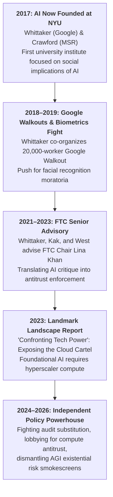

# AI Now Institute

The **AI Now Institute** is an independent, non-profit policy research institute based in New York City, dedicated to analyzing and confronting the concentration of economic, political, and infrastructural power in the artificial intelligence industry. Founded in 2017 by technology researcher [[Meredith Whittaker]] (now President of the Signal Foundation) and critical theorist [[Kate Crawford]] (author of *Atlas of AI*), the institute is currently led by Executive Directors Amba Kak and Sarah Myers West.

Within the critical technology and governance landscape, AI Now operates as the preeminent **political economy, antitrust, and regulatory accountability think tank**. While organizations like the [[Center for Humane Technology]] (CHT) emphasize the psychological perils of the attention economy and the [[Distributed AI Research Institute]] (DAIR) focuses on community-rooted decolonial alternatives, AI Now directly confronts the **infrastructural monopolies of Big Tech**—bridging technical forensic auditing with federal antitrust enforcement, competition policy (e.g., the U.S. Federal Trade Commission), and labor protections.

```text
┌────────────────────────────────────────────────────────────────────────────────────────┐
│                   AI NOW INSTITUTE: INSTITUTIONAL DOSSIER                              │
├──────────────────────┬─────────────────────────────────────────────────────────────────┤
│ Legal Form & Base    │ Non-Profit Policy & Research Institute • New York City, NY      │
├──────────────────────┼─────────────────────────────────────────────────────────────────┤
│ Founded              │ 2017 (Originally at New York University; now independent)       │
├──────────────────────┼─────────────────────────────────────────────────────────────────┤
│ Founders             │ [[Meredith Whittaker]] (Signal President; ex-Google engineer)   │
│                      │ [[Kate Crawford]] (USC Annenberg Prof.; author of *Atlas of AI*)│
├──────────────────────┼─────────────────────────────────────────────────────────────────┤
│ Current Leadership   │ Amba Kak & Sarah Myers West (Co-Executive Directors)            │
├──────────────────────┼─────────────────────────────────────────────────────────────────┤
│ Web Domain           │ ainowinstitute.org                                              │
├──────────────────────┼─────────────────────────────────────────────────────────────────┤
│ Primary Focus Areas  │ • Antitrust & Hyperscaler Cloud Monopoly Cartels                │
│                      │ • Federal Trade Commission (FTC) & International Competition    │
│                      │ • Algorithmic Impact Assessments (AIAs) & Public Procurement    │
│                      │ • Biometric Surveillance & Facial Recognition Moratoria         │
│                      │ • Workplace Surveillance & Algorithmic Management               │
├──────────────────────┼─────────────────────────────────────────────────────────────────┤
│ Ecosystem Role       │ Premier legal, regulatory, and antitrust enforcement brain-     │
│                      │ trust translating technical critique into state regulatory power│
└──────────────────────┴─────────────────────────────────────────────────────────────────┘
```

---

## 🏛️ 1. Origins & Structural Trajectory (2017–Present)



### The Institutional Genesis
In 2017, computer scientist Meredith Whittaker (then leading Google’s Open Research group) and media scholar Kate Crawford established AI Now at New York University as the first university research institute dedicated exclusively to the social, political, and economic implications of AI:
- **Whittaker's Labor Organizing**: In 2018, Whittaker became a central organizer of the historic **Google Walkout for Real Change**, wherein 20,000 Google employees walked off the job protesting sexual harassment, military contracts (Project Maven), and executive retaliation. Following internal corporate backlash, Whittaker departed Google to focus on independent advocacy, later becoming President of Signal.
- **The Regulatory Pivot**: Recognizing that Big Tech voluntary "ethical principles" functioned as mere public relations, AI Now pivoted toward **enforceable state power**. Leadership figures including Amba Kak and Sarah Myers West transitioned into senior advisory roles at the U.S. Federal Trade Commission (FTC) under Chair Lina Khan, directly embedding AI Now’s market-power framework into federal antitrust enforcement.

---

## ⚖️ 2. Core Strategic Pillars & Landmark Interventions

### A. The "Cloud Infrastructure Cartel" & Antitrust Analysis
In its landmark *2023 Landscape Report: Confronting Tech Power* and subsequent scholarship, AI Now dismantled the Silicon Valley myth of "democratized AI":
1. **The Full-Stack Moat**: Foundation models and generative AI are not decentralized innovations; they are completely dependent on a massive, highly concentrated industrial stack:
   - Extreme compute hardware (Nvidia GPU pipelines).
   - Massive hyperscaler cloud infrastructure (**Microsoft Azure, Amazon AWS, Google Cloud**).
   - Trillion-token training datasets harvested via monopoly platforms.
2. **The "Natural Monopoly" Myth**: AI Now exposed how Big Tech uses AI to cement its existing cloud monopolies: Microsoft with OpenAI, Amazon and Google with Anthropic. Startups cannot compete because compute and distribution access are controlled by the very cartels that fund them.
3. **Antitrust Remedies**: AI Now advocates for structural separation, nondiscrimination mandates, public compute utilities, and active FTC/DOJ enforcement under the Sherman and Clayton Acts.

### B. Biometrics, Facial Recognition & Emotion AI Bans
AI Now was the earliest policy institute to call for an immediate **halt to government and commercial facial recognition and biometric affect recognition**:
- Argued that "bias mitigation" is insufficient because biometric surveillance is inherently dangerous to civil liberties and racial justice.
- Successfully pressured municipal and international bodies to adopt strict moratoria on biometric law enforcement surveillance.
- Debunked "Emotion AI" (detecting mood, sincerity, or criminal intent from facial micro-expressions) as unscientific phrenology.

### C. Algorithmic Impact Assessments (AIAs)
Pioneered the concept of **Algorithmic Impact Assessments (AIAs)**—a regulatory blueprint requiring public agencies to conduct public notice, empirical auditing, and community consultation *before* procuring or deploying automated decision-making systems in welfare, healthcare, criminal justice, or education.

### D. Dismantling the "Existential Risk" Smokescreen
In collaboration with researchers from [[Distributed AI Research Institute|DAIR]], AI Now has aggressively critiqued the frontier lab fixation on hypothetical superintelligent extinction:
- Exposing how frontier lab lobbying for "existential safety licensing" functions as **regulatory capture** designed to pull up the ladder behind them and entrench cloud cartels.
- Countering [[The Epistemology of Evasion and AI Legal Strategy|audit substitution]]: insisting that regulators enforce existing antitrust, labor, consumer protection, and civil rights statutes rather than waiting for speculative future AGI treaties.

---

## 🧭 3. Institutional Disambiguation: CHT vs. DAIR vs. AI Now

```text
┌─────────────────────────────────────────────────────────────────────────────────────────────────────────────┐
│                       CRITICAL TECH ORGANIZATIONS: CHT vs. DAIR vs. AI NOW                                  │
├──────────────────────┬─────────────────────────────┬─────────────────────────────┬──────────────────────────┤
│ Metric / Dimension   │ Center for Humane           │ Distributed AI Research     │ AI Now                   │
│                      │ Technology (CHT)            │ Institute (DAIR)            │ Institute                │
├──────────────────────┼─────────────────────────────┼─────────────────────────────┼──────────────────────────┤
│ **Key Figures**      │ Tristan Harris, Aza Raskin  │ [[Timnit Gebru]],           │ Meredith Whittaker,      │
│                      │                             │ Milagros Miceli             │ Kate Crawford, Amba Kak  │
├──────────────────────┼─────────────────────────────┼─────────────────────────────┼──────────────────────────┤
│ **Origins & Seat**   │ Ex-Google Silicon Valley    │ Ex-Google Ethical AI /      │ NYU / Academic & Federal │
│                      │ designers (Bay Area)        │ Global Majority (Remote)    │ Policy, FTC (New York)   │
├──────────────────────┼─────────────────────────────┼─────────────────────────────┼──────────────────────────┤
│ **Primary Focus**    │ Attention economy, addiction│ Racial bias, worker rights  │ Political economy, cloud │
│                      │ psychological hijacking,    │ Global South data labor,    │ monopolies, antitrust,   │
│                      │ "Second Contact" language   │ decolonial datasets,        │ public procurement,      │
│                      │ models & epistemic eating   │ [[TESCREAL and The Merge    │ FTC/DOJ enforcement      │
│                      │                             │ |TESCREAL]] hype critique   │ against Big Tech cartels │
├──────────────────────┼─────────────────────────────┼─────────────────────────────┼──────────────────────────┤
│ **Primary Arena**    │ Public awareness, mass      │ Participatory community     │ Antitrust law, FTC / EU  │
│                      │ media (*Social Dilemma*)    │ science, worker organizing  │ regulatory rule-making   │
├──────────────────────┼─────────────────────────────┼─────────────────────────────┼──────────────────────────┤
│ **Theory of Harm**   │ Misalignment with human     │ Imperialist, extractive,    │ Anticompetitive market   │
│                      │ evolutionary biology        │ racial capitalism           │ power and compute moats  │
└──────────────────────┴─────────────────────────────┴─────────────────────────────┴──────────────────────────┘
```

---

## 🔗 Related Concepts & Entities

- **Concepts**:
  - [[The Epistemology of Evasion and AI Legal Strategy|The Epistemology of Evasion & AI Legal Strategy]]
  - [[The Sincerity Trap and the Sanctified Bottom Line|The Sincerity Trap and the Sanctified Bottom Line]]
  - [[Decoloniality and Empire Technologies|Decoloniality and Empire Technologies]]
  - [[TESCREAL and The Merge|TESCREAL & The Merge]]
  - [[Sociotechnical Epistemology and Model Evaluation|Sociotechnical Epistemology & Model Evaluation]]
  - [[Human Flourishing and Technology Innovation|Human Flourishing & Technology Innovation]]
  - [[The California Ideology|The California Ideology & Silicon Valley Hegemony]]
- **Entities**:
  - [[Distributed AI Research Institute|Distributed AI Research Institute (DAIR)]]
  - [[Center for Humane Technology|Center for Humane Technology (CHT)]]
  - [[Timnit Gebru|Timnit Gebru]]
  - [[OpenAI|OpenAI]]
  - [[Anthropic|Anthropic]]
  - [[Google DeepMind|Google DeepMind]]
  - [[Chad Woodford|Chad Woodford]]

---

## 📚 Primary Works & Reports

- **2018**: AI Now Institute, *Algorithmic Impact Assessments: A Practical Framework for Public Agency Accountability*.
- **2019**: Kate Crawford & Meredith Whittaker, *AI Now 2019 Report*, New York University.
- **2021**: Kate Crawford, *Atlas of AI: Power, Politics, and the Planetary Costs of Artificial Intelligence*, Yale University Press.
- **2023**: Amba Kak & Sarah Myers West, *2023 Landscape Report: Confronting Tech Power*, AI Now Institute.
- **2024–2026**: AI Now Policy White Papers, *Computational Power and Market Concentration in AI: Antitrust Remedies for the Cloud Stack*.
