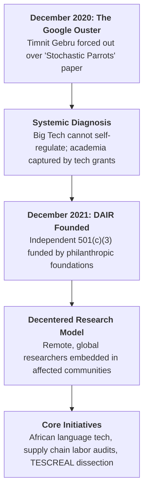

# Distributed AI Research Institute

The **Distributed AI Research Institute (DAIR)** is an independent, non-profit 501(c)(3) research institute founded in December 2021 by computer scientist [[Timnit Gebru]]. Established in the aftermath of Gebru's high-profile forced departure from [[Google DeepMind|Google]] over the landmark *"Stochastic Parrots"* paper, DAIR operates as an autonomous, global counterweight to Silicon Valley’s centralized, compute-maximalist paradigm.

DAIR’s mission is to pioneer **community-rooted, public-interest AI research** free from the commercial agendas, venture capital incentives, and philanthropic capture of Big Tech. While mainstream corporate labs pursue artificial general intelligence (AGI) through massive data harvesting and gigawatt-scale compute, DAIR centers the immediate, material impacts of automated systems on marginalized populations—focusing on algorithmic bias, labor exploitation in AI supply chains, environmental costs, and data sovereignty for the Global Majority.

```text
┌────────────────────────────────────────────────────────────────────────────────────────┐
│             DISTRIBUTED AI RESEARCH INSTITUTE (DAIR): INSTITUTIONAL DOSSIER            │
├──────────────────────┬─────────────────────────────────────────────────────────────────┤
│ Legal Form & Base    │ 501(c)(3) Non-Profit Research Institute • Remote / Distributed  │
├──────────────────────┼─────────────────────────────────────────────────────────────────┤
│ Founded              │ December 2021                                                   │
├──────────────────────┼─────────────────────────────────────────────────────────────────┤
│ Founder & Leadership │ [[Timnit Gebru]] (Founder & Executive Director)                 │
├──────────────────────┼─────────────────────────────────────────────────────────────────┤
│ Core Philanthropic   │ Ford Foundation, MacArthur Foundation, Kapor Center,            │
│ Backers              │ Open Society Foundations, Robert Wood Johnson Foundation        │
├──────────────────────┼─────────────────────────────────────────────────────────────────┤
│ Web Domain           │ dair-institute.org                                              │
├──────────────────────┼─────────────────────────────────────────────────────────────────┤
│ Primary Focus Areas  │ • Global Majority & Indigenous Data Sovereignty                 │
│                      │ • Labor Exploitation in AI Data Annotation & Moderation         │
│                      │ • Environmental & Resource Footprints of Frontier Models        │
│                      │ • Intersectional Algorithmic Auditing (Race, Gender, Caste)     │
│                      │ • Dismantling the [[TESCREAL and The Merge|TESCREAL]] AGI Hype Cycle │
├──────────────────────┼─────────────────────────────────────────────────────────────────┤
│ Ecosystem Role       │ Grassroots, community-accountable research lab offering an      │
│                      │ explicit decolonial alternative to Big Tech monopolies          │
└──────────────────────┴─────────────────────────────────────────────────────────────────┘
```

---

## 🏛️ 1. Origins & Foundational Rationale (2021)



### The Institutional Crisis of Corporate AI Ethics
Throughout the late 2010s, major technology corporations established internal "Ethical AI" teams to address algorithmic bias and public scrutiny. However, Gebru’s experience at Google demonstrated the structural limits of corporate-funded ethics:
1. **The Censorship Boundary**: When research demonstrated that foundational large language models (LLMs) carried severe environmental footprints, encoded systemic racism, and created deceptive illusions of meaning (*Bender & Gebru et al., 2021*), corporate executives demanded the work be retracted.
2. **Academic Philanthropic Capture**: Simultaneously, elite universities had become deeply dependent on Big Tech compute credits, corporate gifts, and faculty chairs, suppressing structural critiques of technology monopolies.
3. **The Autonomous Alternative**: Gebru established DAIR to prove that world-class artificial intelligence research could be conducted completely outside the corporate sphere, accountable directly to impacted communities rather than corporate boards or venture capital returns.

---

## 🔬 2. Core Research Pillars & Methodologies

DAIR organizes its portfolio around an **intersectional, sociotechnical, and decolonial methodology**:

### A. Data Sovereignty & Decolonial Machine Learning
- **African Language & Contextual AI**: Rather than building homogenous, English-dominated foundation models that steamroll linguistic nuance, DAIR builds specialized NLP tools and language datasets for low-resource languages (e.g., Tigrinya, Amharic), partnering with grassroots groups like Masakhane.
- **Land & Spatial Auditing**: Utilizing computer vision and satellite imagery to study historical and ongoing structural inequities—such as tracking the spatial legacy of apartheid urban planning and land distribution in South Africa.

### B. The Human Supply Chain of AI (Labor Justice)
While frontier AI marketing depicts artificial intelligence as ethereal software or "autonomous thinking machines," DAIR exposes AI as an industrial assembly line dependent on hyper-exploited human labor:
- **Global South Data Annotation**: Auditing the working conditions of data labelers and RLHF content moderators in Kenya, Uganda, and the Philippines who review graphic, violent, and traumatic content for sub-minimum wages.
- **Worker Organizing**: Partnering with African content moderators and labor organizers (e.g., the African Content Moderators Union) to demand fair pay, psychological support, and legal recognition.

### C. The TESCREAL Dissection & Critique of AGI Eschatology
Together with philosopher [[Emile P. Torres|Émile P. Torres]], DAIR researchers formulated the **[[TESCREAL and The Merge|TESCREAL]]** framework (Transhumanism, Extropianism, Singularitarianism, Cosmism, Rationalism, Effective Altruism, Longtermism):
- Demonstrates how Silicon Valley’s obsession with hypothetical science-fiction catastrophes ("runaway superintelligence destroying humanity in the future") functions as an intentional ideological smokescreen.
- Exposes how this eschatology excuses present-day harms: copyright theft, environmental devastation, mass surveillance, and economic disenfranchisement.

---

## 🧭 3. Institutional Disambiguation: CHT vs. DAIR vs. AI Now

Within the broader landscape of public-interest technology and critical AI institutions, DAIR occupy a distinct ideological and strategic niche:

```text
┌─────────────────────────────────────────────────────────────────────────────────────────────────────────────┐
│                       CRITICAL TECH ORGANIZATIONS: CHT vs. DAIR vs. AI NOW                                  │
├──────────────────────┬─────────────────────────────┬─────────────────────────────┬──────────────────────────┤
│ Metric / Dimension   │ Center for Humane           │ Distributed AI Research     │ AI Now                   │
│                      │ Technology (CHT)            │ Institute (DAIR)            │ Institute                │
├──────────────────────┼─────────────────────────────┼─────────────────────────────┼──────────────────────────┤
│ **Key Figures**      │ Tristan Harris, Aza Raskin, │ [[Timnit Gebru]],           │ Meredith Whittaker,      │
│                      │ Randima Fernando            │ Milagros Miceli             │ Kate Crawford, Amba Kak  │
├──────────────────────┼─────────────────────────────┼─────────────────────────────┼──────────────────────────┤
│ **Origins & Base**   │ Ex-Google / Silicon Valley   │ Ex-Google Ethical AI /      │ NYU / Academic & Federal │
│                      │ design insiders (Bay Area)  │ Global Majority (Distributed│ Policy, FTC (New York)   │
├──────────────────────┼─────────────────────────────┼─────────────────────────────┼──────────────────────────┤
│ **Primary Focus**    │ • Attention economy         │ • Intersectional racism     │ • Antitrust & monopoly   │
│                      │ • Brainstem hijacking       │ • Global South labor audits │ • Cloud compute chokes   │
│                      │ • Psychological coupling    │ • Decolonial data tools     │ • State regulatory power │
│                      │ • "Second Contact" language │ • [[TESCREAL and The Merge  │ • Enforceable FTC / EU   │
│                      │   models & culture eating   │   |TESCREAL]] hype critique │   antitrust intervention │
├──────────────────────┼─────────────────────────────┼─────────────────────────────┼──────────────────────────┤
│ **Methodology**      │ Cultural storytelling,      │ Participatory empirical     │ Legal, economic, and     │
│                      │ mass media documentaries    │ research, community data,   │ regulatory landscape     │
│                      │ (*The Social Dilemma*)      │ labor ethnographic audits   │ policy reports           │
├──────────────────────┼─────────────────────────────┼─────────────────────────────┼──────────────────────────┤
│ **Critique of Big    │ "The business model of      │ "Imperialist, extractive,   │ "Monopolistic market     │
│ Tech**               │ engagement and addiction"   │ white-supremacist enclosure"│ power and cloud cartel"  │
└──────────────────────┴─────────────────────────────┴─────────────────────────────┴──────────────────────────┘
```

---

## 🔗 Related Concepts & Entities

- **Concepts**:
  - [[Decoloniality and Empire Technologies|Decoloniality and Empire Technologies]]
  - [[The Decolonial Turn and the Coloniality of Being|The Decolonial Turn and the Coloniality of Being]]
  - [[TESCREAL and The Merge|TESCREAL & The Merge]]
  - [[Sociotechnical Epistemology and Model Evaluation|Sociotechnical Epistemology & Model Evaluation]]
  - [[The Epistemology of Evasion and AI Legal Strategy|The Epistemology of Evasion & AI Legal Strategy]]
  - [[The Sincerity Trap and the Sanctified Bottom Line|The Sincerity Trap and the Sanctified Bottom Line]]
  - [[Machine Metaphor|The Machine Metaphor & Computationalism]]
  - [[Human Flourishing and Technology Innovation|Human Flourishing & Technology Innovation]]
- **Entities**:
  - [[Timnit Gebru|Timnit Gebru]]
  - [[AI Now Institute|AI Now Institute]]
  - [[Center for Humane Technology|Center for Humane Technology (CHT)]]
  - [[Google DeepMind|Google / Google DeepMind]]
  - [[OpenAI|OpenAI]]
  - [[Anthropic|Anthropic]]
  - [[Emile P. Torres|Émile P. Torres]]
  - [[Chad Woodford|Chad Woodford]]

---

## 📚 Primary Works & References

- **2021**: Emily M. Bender, Timnit Gebru, Angelina McMillan-Major, Margaret Mitchell, *"On the Dangers of Stochastic Parrots: Can Language Models Be Too Big? 🦜"*, *FAccT '21*, pp. 610–623.
- **2021-12**: Timnit Gebru, *"Announcing the Distributed AI Research Institute (DAIR)"*, DAIR Launch Statement.
- **2023**: Émile P. Torres & Timnit Gebru, *"The TESCREAL Bundle: Eugenics and the Promise of Vast Posthuman Futures"*, *First Monday*.
- **2023–2026**: DAIR Research Team, *Spatial Analysis of Apartheid Legacies & African Language NLP Repositories*, [dair-institute.org](https://dair-institute.org).
