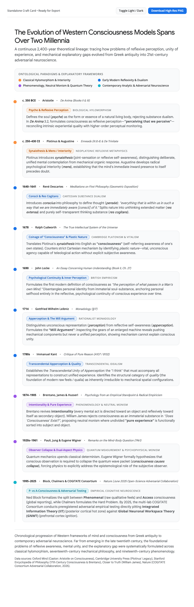
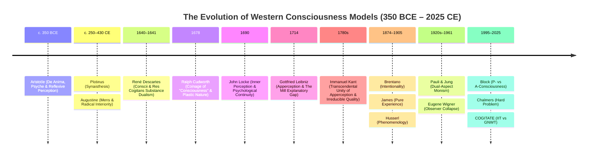

# Timeline of Western Concepts of Consciousness (c. 350 BCE – 2025 CE)

This timeline chronicles the continuous 2,400-year theoretical lineage of Western models of consciousness: tracing how foundational puzzles of reflexive awareness, psychological unity, and mechanical explanatory gaps evolved from classical Greek antiquity through 17th-century mechanical philosophy and 20th-century phenomenology into 21st-century adversarial cognitive neuroscience.

---

> [!TIP] High-Resolution Craft Card & Interactive Explorer
> - **Interactive Version**: [Open Standalone Interactive Card in Browser](../assets/western-concepts-of-consciousness-timeline.html) (with live Light/Dark theme switching and 1-click export).
> - **High-Resolution Graphic**: Rendered directly below.



---



---

## 🧭 Ontological Paradigms & Explanatory Frameworks

The 2,400-year evolution of consciousness models clusters into four broad metaphysical and methodological epochs:

| Epoch | Paradigm | Primary Focus | Key Thinkers |
| :--- | :--- | :--- | :--- |
| **Antiquity to Middle Ages** (c. 350 BCE – 430 CE) | **Classical Hylomorphism & Interiority** | Soul as biological form; reflexive perception (*perceiving that we perceive*); inward spiritual presence. | Aristotle, Plotinus, Augustine |
| **Early Modern Scientific Revolution** (1640–1780s) | **Reflexivity, Mechanism & Dualism** | Substance dualism; linguistic coinage of *"consciousness"*; personal identity as psychological continuity; the mechanical explanatory gap. | [[René Descartes\|Descartes]], Cudworth, [[John Locke\|Locke]], [[Gottfried Wilhelm Leibniz\|Leibniz]], Kant |
| **Late 19th to Mid-20th Century** (1874–1961) | **Phenomenology, Neutral Monism & Quantum Physics** | Intentionality of mental acts; consciousness as a functional relation over "pure experience"; subjective observer collapse. | Brentano, [[William James\|James]], [[Edmund Husserl\|Husserl]], Pauli, Jung, Wigner |
| **Contemporary Era** (1995–2025 CE) | **Analytic Taxonomy & Adversarial Neuroscience** | Division of Phenomenal vs. Access consciousness; the Hard Problem; open-science empirical testing (posterior hot zone vs. fronto-parietal ignition). | [[Ned Block\|Block]], [[David Chalmers\|Chalmers]], [[Giulio Tononi\|Tononi]], [[Stanislas Dehaene\|Dehaene]], [[Christof Koch\|Koch]], COGITATE |

---

## 🏛️ 1. Classical Hylomorphism & Interiority (c. 350 BCE – 430 CE)

### c. 350 BCE — Aristotle: *De Anima* (Books II & III)
- **Framework**: *Biological Hylomorphism*
- **Core Concepts**: *Psyche* (Form of a Living Body), Reflexive Perception (*Aisthesis tes Aistheseos*), Rejecting Substance Separation.
- **Doctrinal Contribution**:
  - In *De Anima* (On the Soul), Aristotle rejects Platonic and proto-Cartesian substance dualism. The soul (*psyche*) is not an incorporeal ghost inhabiting a physical vessel, but the **hylomorphic form** (actuality or functional organization) of a natural organic body possessing the potential for life.
  - In *De Anima* 3.2, Aristotle formulates the first Western theory of **reflexive perception**: *"Since we perceive that we see and hear, it must either be by sight that one perceives that one sees, or by another sense."* Concluding that higher-order sensory monitoring must be intrinsic to the primary perceptual act itself to avoid infinite regress, Aristotle prefigures both modern Higher-Order Thought (HOT) theories and Brentanian reflexive self-awareness.
  - *Vault Cross-Reference*: See [[Neuroscience#The Historical Trajectory of Mind and Brain|Aristotle's Cardiocentric Counter-Thesis]] and the roots of embodied biological form in [[Functionalism#Sethian Biological Functionalism The Beast Machine & Living Wetware|Sethian Biological Functionalism]].

### c. 250–430 CE — Plotinus & Augustine: *Enneads* & *De Trinitate*
- **Framework**: *Neoplatonic Reflexive Metaphysics & Radical Interiority*
- **Core Concepts**: *Synaisthesis* (Joint-Sensation / Self-Perception), *Mens* (The Self-Present Mind), Inward Epistemology.
- **Doctrinal Contribution**:
  - **Plotinus** (*Enneads* III.8.4, V.3): Formulates the concept of **synaisthesis**—a unified, reflexive internal consciousness whereby the intellect (*Nous*) contemplates its own operations. Plotinus distinguishes reflexive awareness from passive somatic reaction, arguing that higher mental life requires the mind to fold back upon itself in unified self-presence.
  - **Augustine of Hippo** (*De Trinitate*, Books IX–X; *De Civitate Dei* XI.26): Formalizes the Western turn toward radical psychological **interiority** (*mens*). Anticipating Descartes' cogito by twelve centuries (*"Si fallor, sum"* — "If I am mistaken, I exist"), Augustine demonstrates that the mind's direct intuitive self-awareness precedes any sensory observation of the external world. The mind does not infer its own existence; it knows itself immediately by being present to itself.
  - *Vault Cross-Reference*: Prefigures the phenomenological inwardness detailed in [[Phenomenology and Embodied Cognition]] and the historical critiques of secular disenchantment in [[Wisdom and the Meaning Crisis]].

---

## ⚙️ 2. Early Modern Reflexivity, Mechanism & The Explanatory Gap (1640–1780s)

### 1640–1641 — René Descartes: *Meditations on First Philosophy*
- **Framework**: *Cartesian Substance Dualism & Mechanical Reduction*
- **Core Concepts**: *Conscius*, *Pensée* (Thought), *Res Cogitans* vs. *Res Extensa*, Radical Epistemic Asymmetry.
- **Doctrinal Contribution**:
  - In the Second Replies and Geometrical Exposition of the *Meditations*, [[René Descartes|René Descartes]] introduces the Latin *conscius* into philosophical taxonomy to define thought (*pensée*): *"Thought is a word that covers everything that is within us in such a way that we are immediately aware [conscii] of it."*
  - Descartes partitions the cosmos into two mutually exclusive ontological substances:
    1. **Res Extensa**: Spatially extended, divisible, mechanical matter operating strictly under geometric and deterministic laws (including animal bodies and human physiology).
    2. **Res Cogitans**: Non-extended, indivisible, purely subjective thinking substance whose essence is transparent self-consciousness.
  - By stripping the material world of qualitative sensations (relocating warmth, color, and pain entirely into the subjective mind), Descartes inadvertently creates the modern **Mind-Body Problem** and the foundation for the explanatory gap.
  - *Vault Cross-Reference*: See [[Mechanistic Materialism and Reasoning as Reckoning]], [[Early Modern Roots of the Computational Mind]], and [[René Descartes]].

### 1678 — Ralph Cudworth: *The True Intellectual System of the Universe*
- **Framework**: *Cambridge Platonism & Teleological Vitalism*
- **Core Concepts**: Coining *"Consciousness"* in English, *Plastic Nature*, Non-Conscious Teleological Agency.
- **Doctrinal Contribution**:
  - Ralph Cudworth explicitly translates Plotinus's *synaisthesis* into English, giving birth to the modern noun **"consciousness"**: defined as the mind's reflexive capacity to be an internal witness to its own thoughts (*"duplication of the animal life into self-reflection"*).
  - Crucially, Cudworth attacks strict Cartesian mechanism by formulating the doctrine of **Plastic Nature**: an unconscious, living, organizing principle operative throughout biology that executes purposive physiological ends without explicit subjective awareness. In doing so, Cudworth prefigures modern cognitive science's distinction between automated, non-conscious computation and phenomenally conscious representation.
  - *Vault Cross-Reference*: See the boundary between automated regulation and felt agency in [[Basal Cognition and Diverse Intelligence]] and [[Michael Levin]].

### 1690 — John Locke: *An Essay Concerning Human Understanding*
- **Framework**: *British Empiricism & Psychological Continuity*
- **Core Concepts**: *"The Perception of What Passes in a Man's Own Mind"*, *Tabula Rasa*, Personal Identity, The Hypothesis of *"Thinking Matter"*.
- **Doctrinal Contribution**:
  - In Book II, Chapter 27 of the *Essay*, [[John Locke|John Locke]] codifies the first empirical definition of consciousness in the English language: *"Consciousness is the perception of what passes in a man's own mind."*
  - Locke executes a momentous conceptual divorce: **he disentangles personal identity from immaterial substance**. Demonstrating that the identity of the "Self" does not depend on an immortal Cartesian soul or physical substance, Locke grounds identity strictly in **psychological continuity**—the backward-reaching span of reflexive memory and conscious awareness.
  - In Book IV, Chapter 3, Locke introduces the explosive hypothesis of **"Thinking Matter"**: suggesting that God could, if He chose, *"superadd to matter a faculty of thinking"*, establishing the earliest theoretical ancestor of physicalist functionalism.
  - *Vault Cross-Reference*: See [[Empiricism and Tabula Rasa]], [[Early Modern Roots of the Computational Mind#1 Thesis & Definition]], and [[John Locke]].

### 1714 — Gottfried Wilhelm Leibniz: *Monadology* & *New Essays*
- **Framework**: *Rationalist Monadology & Pre-Established Harmony*
- **Core Concepts**: *Perception* vs. *Apperception*, *Petites Perceptions*, **The Mill Argument** (§17).
- **Doctrinal Contribution**:
  - [[Gottfried Wilhelm Leibniz|Gottfried Wilhelm Leibniz]] provides the definitive early modern distinction between unconscious mental states and conscious awareness:
    - **Perception**: Unconscious informational representation (*petites perceptions*, like the sound of individual water droplets).
    - **Apperception**: Reflexive self-consciousness that synthesizes and monitors lower representations.
  - In *Monadology* §17, Leibniz delivers his immortal refutation of mechanical reductionism—**Leibniz's Mill**:
    > *"Supposing there were a machine so constructed as to produce thought, feeling, and perception, we could imagine it increased in size while keeping the same proportions, so that one could enter into it as into a mill. That being so, we should, on examining its interior, find only parts which push one another, and never anything by which to explain a perception."*
  - Leibniz proves 300 years before Searle's Chinese Room and Chalmers' Hard Problem that formal syntactic collisions ("parts pushing parts") cannot bridge the explanatory gap to phenomenal experience.
  - *Vault Cross-Reference*: See [[Mechanistic Materialism and Reasoning as Reckoning#2 Leibniz's Multi-Front War The Three Targets of the Mill]], [[Computation vs Nature and the Observer-Relative Fallacy]], and [[Gottfried Wilhelm Leibniz]].

### 1780s — Immanuel Kant: *Critique of Pure Reason*
- **Framework**: *Transcendental Idealism*
- **Core Concepts**: *Transcendental Unity of Apperception* (A107 / B132), The Synthetic *"I Think"*, The Category of *Quality* (Irreducibility of Qualia).
- **Doctrinal Contribution**:
  - In the Transcendental Deduction of the *Critique of Pure Reason*, [[Immanuel Kant|Immanuel Kant]] establishes that isolated sensory impressions (*the manifold of intuition*) can never cohere into an intelligible world without the **Transcendental Unity of Apperception**. The synthetic proposition *"The 'I think' must be able to accompany all my representations"* acts as the formal, non-empirical glue binding subjective experience across time.
  - Furthermore, Kant isolates the structural category of **Quality** (Reality, Negation, Limitation) and sensation: demonstrating that raw qualitative sensations (the immediate ancestors of modern *qualia*) possess an intensive magnitude that can never be fully derived from or replaced by mere mechanical-spatial relations (*Quantity*).
  - *Vault Cross-Reference*: See [[Idealism and Consciousness]], [[Phenomenology and Embodied Cognition]], and [[Hard Problem of Consciousness]].

---

## 🌌 3. Phenomenology, Neutral Monism & Quantum Measurement (1874–1961)

### 1874–1905 — Brentano, James, & Husserl: Phenomenology & Neutral Monism
- **Framework**: *Descriptive Psychology, Radical Empiricism & Pure Experience*
- **Core Concepts**: *Intentionality* (*Intentional Inexistence*), Stream of Consciousness, Rejection of Mental Substance, *Pure Experience*.
- **Doctrinal Contribution**:
  - **Franz Brentano** (*Psychology from an Empirical Standpoint*, 1874): Revives scholastic **intentionality** as the defining criterion of mental phenomena: every conscious act is directed toward an object (*aboutness*), while simultaneously containing an intrinsic, secondary consciousness of itself.
  - **William James** (*Principles of Psychology*, 1890; *"Does 'Consciousness' Exist?"*, 1904): Dismantles the reification of consciousness as an immaterial entity or "stuff." Proposing **Neutral Monism** and **Radical Empiricism**, James argues that the universe consists of a single primal substrate—**"pure experience"**. "Consciousness" is not a separate spiritual substance, but a dynamic *functional relation* sorting undivided pure experience into knower (subject) and known (object).
  - **Edmund Husserl** (*Logical Investigations*, 1900–1901; *Ideas I*, 1913): Founds transcendental phenomenology by applying the *epoché* (phenomenological bracket), suspending naturalistic assumptions about the physical world to systematically describe the invariant structures of lived, first-person subjective experience (*Lebenswelt*).
  - *Vault Cross-Reference*: See [[Phenomenology and Embodied Cognition]], [[Edmund Husserl]], [[Duration Memory and the Cinematographic Illusion of Thought]], and [[Cognitive Phenomenology and Intellectual Feeling]].

### 1920s–1961 — Pauli, Jung, & Eugene Wigner: Quantum Measurement & Observer Collapse
- **Framework**: *Dual-Aspect Psychophysical Monism & Quantum Epistemology*
- **Core Concepts**: The Measurement Problem, *Consciousness Causes Collapse*, The Pauli-Jung Conjecture, Psychophysical Isomorphism.
- **Doctrinal Contribution**:
  - The advent of quantum mechanics destroys classical clockwork materialism. The mathematical formalism of the Schrödinger wave equation demonstrates deterministic evolution until a physical measurement occurs, collapsing superposed possibilities into a single definite eigenstate.
  - **Wolfgang Pauli & Carl Jung** (1930s–1950s): Collaborate on **Dual-Aspect Monism**, proposing that the physical (quantum reality) and mental (psyche/archetypes) are complementary, ontologically indivisible perspectives on a single underlying reality (*unus mundus*).
  - **Eugene Wigner** (*Remarks on the Mind-Body Question*, 1961): Follows [[John von Neumann|von Neumann's]] analysis of the measurement chain to its logical conclusion: since all physical measuring instruments are themselves composed of quantum particles governed by unitary evolution, the only non-physical intervention capable of terminating the von Neumann regress and collapsing the wave function is the **conscious observation of an experiencing subject** (*"Consciousness Causes Collapse"*).
  - *Vault Cross-Reference*: See [[Quantum Integrated Information Theory and Collapse]] and [[Kelvin McQueen]].

---

## 🔬 4. Analytic Taxonomy & Adversarial Cognitive Neuroscience (1995–2025)

### 1995 — Block & Chalmers: The Modern Analytic Taxonomy
- **Framework**: *Analytic Philosophy of Mind & Property Dualism*
- **Core Concepts**: Phenomenal ($P$) vs. Access ($A$) Consciousness, The **Hard Problem**, The Explanatory Gap Revisited, Philosophical Zombies.
- **Doctrinal Contribution**:
  - [[Ned Block|Ned Block]] (*"On a Confusion about a Function of Consciousness"*, 1995): Enforces the decisive taxonomy between:
    1. **Phenomenal Consciousness ($P$-Consciousness)**: The raw, qualitative, experiential "what-it-is-like" feels (qualia, pain, color sensations).
    2. **Access Consciousness ($A$-Consciousness)**: Representations globally available to cognitive systems for verbal reporting, executive decision-making, reasoning, and voluntary motor action.
  - [[David Chalmers|David Chalmers]] (*"Facing Up to the Problem of Consciousness"*, 1995; *The Conscious Mind*, 1996): Formalizes the **Hard Problem of Consciousness**: distinguishing the "easy" problems (mechanistic information processing, attention, reportability, discrimination) from the truly hard problem: *Why should physical processing give rise to rich inner subjective experience at all?* Formulates the philosophical zombie argument to demonstrate the metaphysical failure of reductive physicalism.
  - *Vault Cross-Reference*: See [[Hard Problem of Consciousness]], [[Ned Block]], [[David Chalmers]], and [[Functionalism#Classical Counter-Arguments & Refutations]].

### 2025 — The COGITATE Consortium: Open-Science Adversarial Testing
- **Framework**: *Empirical Cognitive Neuroscience & Preregistered Adversarial Collaborations*
- **Core Concepts**: Global Neuronal Workspace Theory (GNWT) vs. Integrated Information Theory (IIT), Posterior Cortical "Hot Zone" vs. Fronto-Parietal Ignition, Nature (June 2025).
- **Doctrinal Contribution**:
  - In a historic landmark for open science and consciousness research, the multi-institution **COGITATE Consortium** publishes its preregistered adversarial empirical tests in *Nature* (June 2025), directly pitting the two leading neuroscientific theories of consciousness against each other:
    1. **Global Neuronal Workspace Theory (GNWT)** ([[Stanislas Dehaene|Dehaene]], Changeux): Predicts consciousness arises from late ($\approx 300\text{ ms}$) fronto-parietal ignition and global broadcasting across prefrontal cortex hubs.
    2. **Integrated Information Theory (IIT)** ([[Giulio Tononi|Tononi]], [[Christof Koch|Koch]]): Predicts consciousness is identical to intrinsic cause-effect power ($\Phi$), situated primarily in a **posterior cortical hot zone** (parieto-occipito-temporal cortex) exhibiting sustained grid-like recurrent connectivity regardless of task reporting.
  - *Empirical Findings*: The results challenged both theories: IIT's prediction of sustained posterior cortical synchronization was largely corroborated during stimulus presentation, while GNWT's requirement for universal prefrontal ignition failed in non-report perceptual paradigms. However, IIT's specific higher-order information feedback predictions were partially contested, establishing that neither classical computational broadcasting nor existing formal IIT accounts are fully complete.
  - *Vault Cross-Reference*: See [[Scientific Theories of Consciousness#The Four Dominant Empirical Paradigms]], [[2026-10-18-seth-block-tononi-three-reasons-ai-is-not-conscious.md|Seth, Block, & Tononi (Nature, 2026)]], and [[AI Consciousness and Sentience]].

---

## 🧩 Vault Graph Connections & Thematic Synthesis

```text
┌────────────────────────────────────────────────────────────────────────┐
│                   THE ARCHITECTURE OF CONSCIOUSNESS                    │
├────────────────────────────────────────────────────────────────────────┤
│ 1. Hylomorphic Roots  ──▶ Aristotle (De Anima)                         │
│                           └─▶ Basal Cognition & Sethian Beast Machine  │
│                                                                        │
│ 2. The Mechanical Gap ──▶ Descartes (Dualism) ──▶ Leibniz (The Mill)   │
│                           └─▶ Hobbes / Locke (Thinking Matter & CTM)   │
│                                                                        │
│ 3. Phenomenology      ──▶ Brentano / Husserl / James (Pure Experience) │
│                           └─▶ 4E Embodied Cognition & Jonas Autopoiesis│
│                                                                        │
│ 4. Scientific Testing ──▶ Block (P vs A) ──▶ Chalmers (Hard Problem)   │
│                           └─▶ COGITATE (IIT vs GNWT in Nature 2025)    │
│                               └─▶ Seth, Block, Tononi AI Critique 2026 │
└────────────────────────────────────────────────────────────────────────┘
```

### Core Related Concepts
- [[Scientific Theories of Consciousness]]: Empirical analysis of GWT, IIT, Higher-Order Theories (HOT), and Predictive Processing.
- [[Hard Problem of Consciousness]]: The explanatory gap, the "Real Problem" (Anil Seth), and the trilemma of machine sentience.
- [[Early Modern Roots of the Computational Mind]]: Detailed examination of Hobbes, Locke, and Leibniz’s foundational dispute over thinking matter.
- [[Mechanistic Materialism and Reasoning as Reckoning]]: Hobbes' formalization of algorithmic thought and Leibniz’s mechanical critique.
- [[Empiricism and Tabula Rasa]]: Locke's epistemological architecture and inner perception.
- [[Phenomenology and Embodied Cognition]]: Merleau-Ponty, Dreyfus, and the critique of disembodied symbolic AI.
- [[Quantum Integrated Information Theory and Collapse]]: Wigner, von Neumann, and modern quantum measurement models of mind.
- [[Functionalism]]: Metaphysical taxonomy of computational, biological, and extended functionalism.
- [[AI Consciousness and Sentience]]: Why LLMs exhibit functional access simulation while lacking metabolic and phenomenological substrate requirements.

### Sister Master Timeline
- [[AGI and Scaling Debates]]: Chronicles the technological, scaling, political-economic, and legal trajectory of artificial intelligence (1650–2026).
